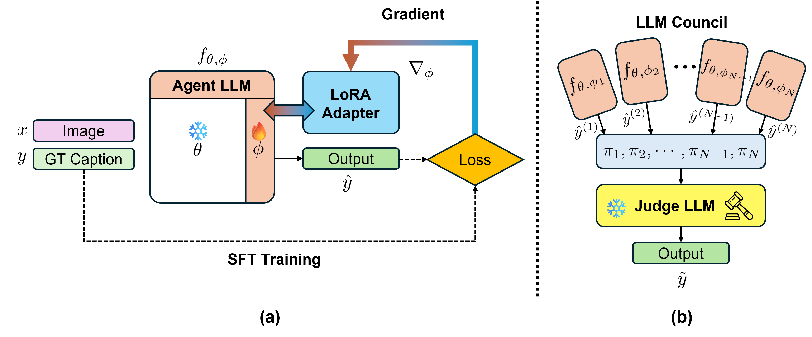

# SMILE: A Structured Multi-Agent Clinical Reasoning for Liver Ultrasound Understanding

<!-- [Download PDF](https://github.com/CMME-Lab/SMILE) -->

Haris Ghafoor, Minjee Seo, Seonaeng Cho, Keungmo Yang, Jaejun Lee, Kyungho Yoon


## Summary

SMILE interprets a liver ultrasound study with three complementary specialist agents — an image interpretation agent for morphological descriptions, a clinical-stage reasoning agent, and a VQA agent for targeted queries — and consolidates their outputs through a judge VLM using a consensus filtering prompt. On a public and an internal clinical dataset it improves ROUGE-1 by up to 19.0% and clinical F1 by 18.8% over state-of-the-art VLMs.



## Installation

### 1. Environment

```bash
pip install -e ".[all]"
```

### 2. Datasets

Download the datasets from [link](TODO) and place them under `data/`.


We also release our internal Dataset-2 with this work. [01_dataset_overview.ipynb](../smile-dataset/notebooks/01_dataset_overview.ipynb) walks through its schema, labels and images, and shows how to build a patient-grouped split for your own training runs.
Statistics: 1,417 liver ultrasound images obtained from 286 patients (mean age: $55.18 \pm 16.04$ years; 105 males (36.7\%) and 181 females (63.3\%)), along with 286 corresponding clinical descriptions.

### 3. Models

Download the three LoRA adapters from [link](https://drive.google.com/drive/folders/12LpN1XdVRb_BUdjzGD-AZFr-3eQormW-?usp=sharing) and place them under `weights/`:

```
weights/
├── agent_a/
├── agent_b/
└── agent_c/
```

### 4. Training

```bash
python scripts/train_agent.py --config configs/agents/agent_a.yaml \
    --records data/d1/train.json --output-dir weights/agent_a
```

### 5. Evaluation

```bash
python scripts/run_council.py --records data/d1/test.json --dataset d1 \
    --out runs/d1_council.json

python scripts/evaluate.py --results runs/d1_council.json --dataset d1 \
    --pred-col judge_final_response
```

## Cite as
<!-- 
```bibtex
@inproceedings{ghafoor2027smile,
  author    = {Ghafoor, Haris and Seo, Minjee and Cho, Seonaeng and
               Yang, Keungmo and Lee, Jaejun and Yoon, Kyungho},
  title     = {SMILE: A Structured Multi-Agent Clinical Reasoning for Liver Ultrasound Understanding},
  booktitle = {Proceedings of the IEEE/CVF Winter Conference on Applications of Computer Vision (WACV)},
  year      = {2027}
}
``` -->

## Disclaimer

If you use this codebase, the models or the dataset, please cite the paper above.
